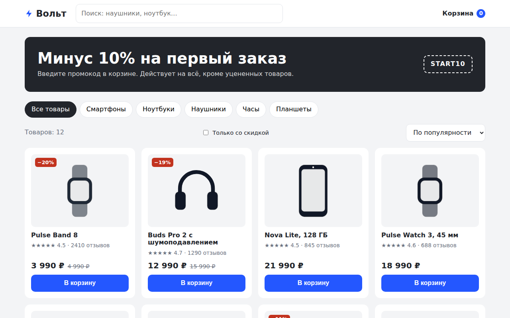

# Вольт: интернет-магазин электроники

Многостраничный магазин электроники на чистом JavaScript без сборщика: каталог, карточка товара, корзина и оформление заказа. Корзина общая для всех страниц и хранится в `localStorage`, а иллюстрации товаров рисуются в SVG, поэтому внешних картинок нет совсем.



## Возможности

**Каталог**
- Пять категорий (смартфоны, ноутбуки, наушники, часы, планшеты) переключаются чипами
- Поиск из шапки по названию товара и категории, работает с любой страницы
- Фильтр «Только со скидкой» и сортировка: по популярности, цене, рейтингу
- Бейдж скидки в процентах считается из старой и новой цены
- Пустое состояние с подсказкой, если по запросу ничего не нашлось

**Карточка товара**
- Выбор цвета: иллюстрация перекрашивается сразу
- Количество от 1 до 10, таблица характеристик, хлебные крошки
- Блок «С этим покупают»: популярные товары из других категорий

**Корзина и заказ**
- Изменение количества, удаление позиций, счётчик товаров в шапке
- Промокоды `START10` (10%) и `VOLT5` (5%), код сохраняется до конца сессии
- Доставка 490 ₽, бесплатно от 30 000 ₽, подсказка «до бесплатной доставки ещё…»
- Курьер или самовывоз: при самовывозе поле адреса скрывается
- Проверка имени, телефона и адреса, маска телефона `+7 (___) ___-__-__`, номер заказа после оформления

## Стек

HTML5, CSS3 (Grid, custom properties), JavaScript без библиотек, `localStorage` и `sessionStorage`, шрифт Golos Text из Google Fonts.

## Как запустить

Сборка не нужна: откройте `index.html` в браузере.

Или через локальный сервер:

```bash
python -m http.server 8000
# затем http://localhost:8000
```

## Настройка

- Товары, цены, цвета и характеристики: массив `PRODUCTS` в `js/products.js`, категории там же в `CATEGORIES`
- Промокоды: объект `PROMO` в начале `js/cart.js`
- Порог бесплатной доставки и её цена: константы `FREE_FROM` и `DELIVERY` в `js/cart.js`

## Структура проекта

```
index.html        # каталог
product.html      # карточка товара (?id=)
cart.html         # корзина и оформление
css/style.css     # стили и адаптив
js/products.js    # товары, категории, SVG-иллюстрации
js/store.js       # хелперы, корзина, шапка, карточка товара в сетке
js/catalog.js     # фильтры, поиск, сортировка
js/product.js     # страница товара
js/cart.js        # корзина, промокоды, доставка, оформление
```

## Как это устроено

- Корзина хранится как массив `{id, color, qty}`: один товар в разных цветах лежит отдельными строками. Чтение и запись обёрнуты в `try/catch`, чтобы страница не падала при недоступном хранилище
- Шапка и подвал вставляются из `js/store.js`, поэтому разметка не дублируется в трёх HTML-файлах
- Иллюстрации строит функция `deviceSVG(cat, color)`: у каждой категории свой набор фигур, цвет подставляется из выбранного варианта
- Итог корзины считается одной функцией `totals()`: сумма, скидка по промокоду, доставка с учётом порога и способа получения
- Доступность: `aria-pressed` у чипов и образцов цвета, `role="status"` и `role="alert"` для сообщений, видимый `:focus-visible`
- Адаптив: до 860 px карточка товара и корзина в одну колонку, поиск в шапке скрывается

## Идеи для развития

- Поиск на мобильной ширине, сейчас он скрыт
- Сравнение товаров и список избранного
- Отправка заказа на сервер или в Telegram-бота

## Лицензия

Концепт-сайт, реального бизнеса за ним нет.

MIT © 2026 whysafe. Telegram: [@yawhysafe](https://t.me/yawhysafe) · Сайт: [whysafe.ru](https://whysafe.ru)
